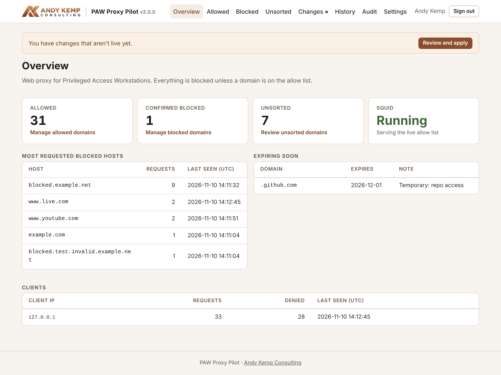
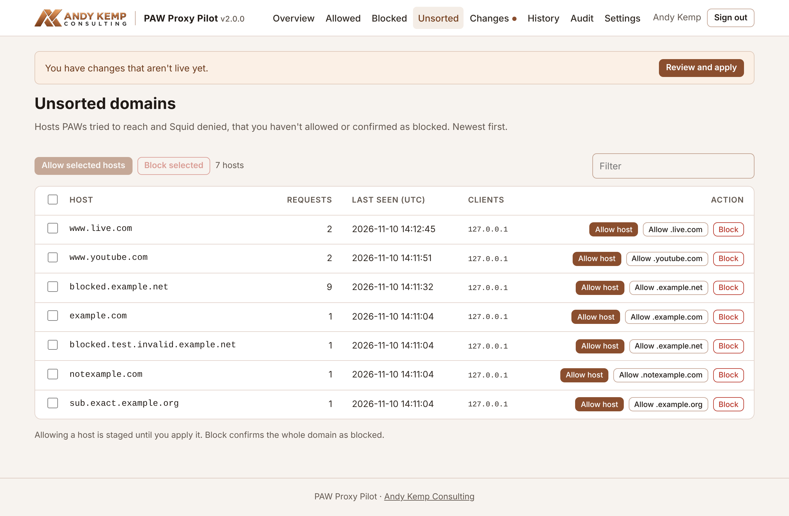

# PAW Proxy Pilot

A small, Entra-protected web admin for a **default-deny Squid proxy** serving Privileged Access Workstations (PAWs). PAWs can only reach the domains on the allow list; everything else is blocked.

- **Allow list:** allow an exact host (`graph.microsoft.com`) or a domain with all its subdomains (`.microsoft.com`). Each entry can carry a reason and an expiry date.
- **Unsorted:** hosts PAWs tried to reach and Squid denied, with request counts, last seen time and which clients asked. Allow the host, allow the whole domain, or confirm it as blocked so it stops showing up.
- **Staged changes:** edits stay staged until you apply them. You see a diff first, the old list is backed up, Squid checks its configuration and reloads without dropping connections. If Squid rejects the config or the reload fails, the previous list is put back.
- **Expiry:** an allowed domain with an expiry date is removed from Squid automatically after its last day.
- **History and audit:** restore any applied version in one click. The audit log records sign-ins, every allow/block change, applies and expiries.
- **Entra ID sign-in:** no local accounts or passwords. Access needs an app role (or an allow-list of users), so you can put Conditional Access and phishing-resistant MFA in front of it.





---

## How it fits together

```
PAWs ──► Squid on this server, port 3128 ──► only domains in /etc/squid/allowed_paw.acl
Admins ─► https://pawproxy.example.com:8443 ─► PAW Proxy Pilot (internal network only)
```

PAW Proxy Pilot runs as an unprivileged `pawpilot` service account. Its only root access is one sudo rule for `/usr/local/sbin/pawpilot-apply`, which takes no arguments. That helper:

1. copies the staged list somewhere only root can write,
2. refuses it unless every line is a plain domain entry,
3. backs up and installs the new list,
4. runs `squid -k parse`,
5. reloads Squid, restoring the previous list if either of the last two steps fails.

The `pawpilot` account reads Squid's access log through the `proxy` group.

---

## Before you install

1. **A server.** Ubuntu Server 24.04 LTS (Debian 12 also works), on a network the PAWs can reach.
2. **A DNS name** for the web page, e.g. `pawproxy.example.com`, pointing at the server's internal IP. It is needed for the certificate and the Entra redirect URI.
3. **A certificate.** By default the installer gets a Let's Encrypt certificate using a Cloudflare DNS challenge, so you need a Cloudflare API token with **Zone · DNS · Edit** on that zone. Pass `--self-signed` to skip this.
4. **A Windows or Mac machine** with PowerShell to create the Entra app registration. Sign in as a Global Administrator, or Cloud Application Administrator plus Privileged Role Administrator.

---

## Install

On your Windows or Mac machine, create the Entra app. It prints a setup code:

```powershell
pwsh ./deploy/New-PAWProxyPilotApp.ps1 -HostName pawproxy.example.com -AssignTo you@example.com
```

On the server:

```bash
git clone https://github.com/andy-kemp/squid_allow_app.git
```

```bash
cd squid_allow_app
```

```bash
sudo ./install.sh
```

The installer asks for the hostname and port, the setup code, and which networks the PAWs are on. It then:

- installs Squid and writes a default-deny `squid.conf` limited to those networks (the old file is backed up),
- installs a starter allow list of Microsoft admin endpoints if there is no list yet,
- installs the block page PAW users see,
- sets up the `pawpilot` service on the port you chose (8443 by default).

Then point the PAWs' proxy setting at the server on port 3128, and open `https://pawproxy.example.com:8443`.

| Command | What it does |
| --- | --- |
| `sudo ./install.sh` | First install, or update to the version in this folder |
| `sudo ./install.sh --reconfigure` | Ask the hostname, port, Entra and certificate questions again |
| `sudo ./install.sh --entra` | New setup code or rotated client secret only |
| `sudo ./install.sh --self-signed` | Use a self-signed certificate |
| `sudo ./install.sh --squid-conf` | Rewrite `squid.conf` (asks for the PAW networks again) |

To update, `git pull` and run `sudo ./install.sh` again. It keeps your settings, database, certificates, allow list and `squid.conf`.

### Upgrading from version 1 (the Flask app)

Run the installer on the same server. The first time the new version starts it imports the existing `/etc/squid/allowed_paw.acl` as the allow list and `/etc/squid/hidden_domains.txt` as the blocked list. The installer offers to stop the old `paw_proxy_pilot` service and its nginx site. Local users, passwords and MFA secrets are not migrated: sign-in is Entra ID only. MySQL, nginx and `/opt/paw_proxy_pilot` are left in place for you to remove.

An existing `squid.conf` that already uses the allow list is kept as it is. The version 1 config let any source address use the proxy; run `sudo ./install.sh --squid-conf` to limit it to your PAW networks.

---

## Settings

Everything is in `/etc/pawpilot/pawpilot.env`; see [deploy/pawpilot.env.example](deploy/pawpilot.env.example). Restart after editing:

```bash
sudo systemctl restart pawpilot
```

The app will not start without `PAWPILOT_SESSION_SECRET`, and nobody can sign in unless an app role or an allow-list of users is configured. The client secret expiry is shown in the app from 30 days out; rotate it by running the PowerShell script again and then `sudo ./install.sh --entra`.

## Security notes

- Keep the web port and 3128 off the internet. Neither should be port-forwarded.
- Add a Conditional Access policy for the PAW Proxy Pilot app requiring phishing-resistant MFA.
- Prefer exact hosts over whole domains. Squid only writes the widest of any overlapping entries, and the app shows which entries a wider one already covers.
- HTTPS requests are denied at the `CONNECT` stage, so browsers show their own "proxy refused" error for those; the block page appears for plain HTTP.

## Development

```bash
pip install -r requirements.txt pytest httpx
```

```bash
python -m pytest
```

The tests use a fake apply helper and a sample access log, so they need neither Squid nor Entra.

## License

MIT
